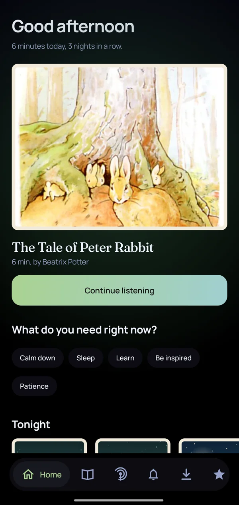
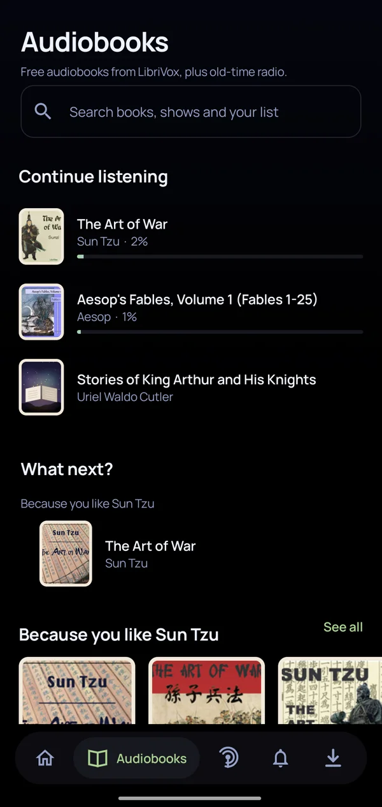
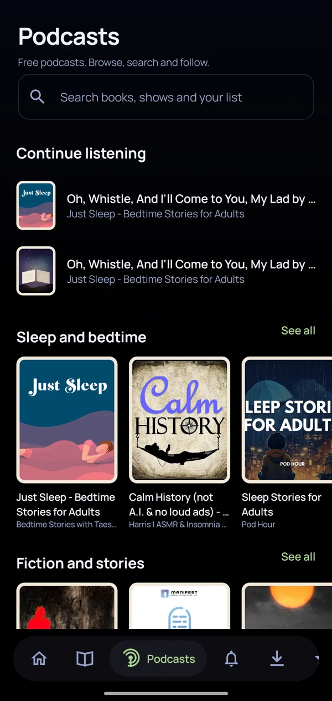
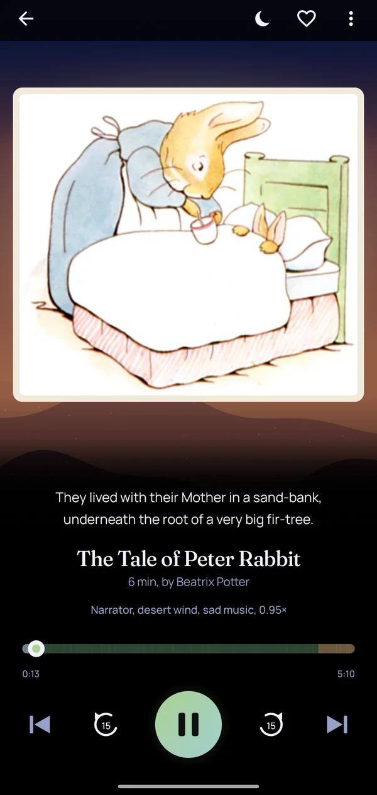
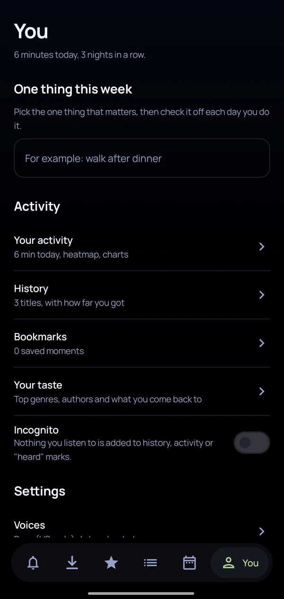

<div align="center">


# Lamplore

### Stories that calm the heart.

Free, open source Android app for calm listening: 22,000 audiobooks, podcasts and illustrated bedtime stories, with on-device voices, real field recordings and no ads.

[](https://github.com/mahir-hs/lamplore/releases/latest/download/lamplore.apk)
[](https://mahir-hs.github.io/lamplore/)


<br>

    

</div>

---

## Why Lamplore

Doom-scrolling at midnight helps nobody. Lamplore gives you a quiet alternative: put the phone down and let a voice take you somewhere calm. It is secular and family safe: fables, wisdom tales from many cultures, classics and sleep stories.

## What you get

| | |
|---|---|
| **22,000 free audiobooks** | All of LibriVox plus old-time radio, streamed live from the Internet Archive. Nothing is re-hosted. |
| **Podcasts** | Charts, search, follow, and an Updates feed that checks in the background. |
| **Illustrated sleep stories** | Picture-book plates that turn as the story moves, with the sentence being read underneath. |
| **Story Director** | Decides who speaks, how fast, and which sound sits underneath. Narrator, young and deep character voices, all on-device with Piper and Kokoro. |
| **Real field recordings** | 10 scenes (rain, storm, ocean, forest, fire, desert...) and 7 instrumental beds, with animated scenes to match. |
| **Offline, properly** | Whole books or chosen chapters, parallel downloads with resume, Wi-Fi only, delete after listening. |
| **Sleep timer and resume** | Lock screen controls, 0.8x to 2x speed, every title remembers its place. |
| **Your listening** | History, bookmarks with notes, a 17-week heatmap, your taste, custom lists and saved searches. |
| **Private by design** | No account, no tracking, incognito mode, optional biometric lock, local backup and restore. |
| **Looks** | Midnight or AMOLED black with accent colours. |

## Install

1. [Download `lamplore.apk`](https://github.com/mahir-hs/lamplore/releases/latest/download/lamplore.apk) (about 118 MB) on your Android phone.
2. Open it and allow installs from your browser or file manager when Android asks.
3. Press play. Optional: add better offline voices under Settings.

To update, install the newest APK over the old one. Your history and downloads stay.

Requires Android 8.0 or newer. Not on the Play Store, by design.

## Build it yourself

```
set JAVA_HOME=C:\Program Files\Java\jdk-21
set ANDROID_HOME=D:\Android\Sdk
gradlew assembleDebug
```

You also need the voice library, which is too big to commit. Full instructions, architecture notes and how the Director, downloads and Listen tab work are in **[docs/DEVELOPMENT.md](docs/DEVELOPMENT.md)**.

Stack: Kotlin 2.4, Jetpack Compose, Media3, WorkManager, sherpa-onnx, AGP 9.5, compileSdk 37, minSdk 26.

## Credits

Audiobooks come from [LibriVox](https://librivox.org) via the [Internet Archive](https://archive.org). Podcast data comes from Apple's public iTunes API and each show's own RSS feed. Field recordings and picture-book plates keep their own licences: see [SOUNDS.md](docs/licenses/SOUNDS.md) and [IMAGES.md](docs/licenses/IMAGES.md). Fonts are Fraunces and Manrope under the SIL OFL.

## Contributing

Code is MIT licensed (see [LICENSE](LICENSE)); bundled media keeps its own licences. Bug reports and ideas are welcome in [Issues](https://github.com/mahir-hs/lamplore/issues). If Lamplore helps you sleep better, a star helps others find it.
